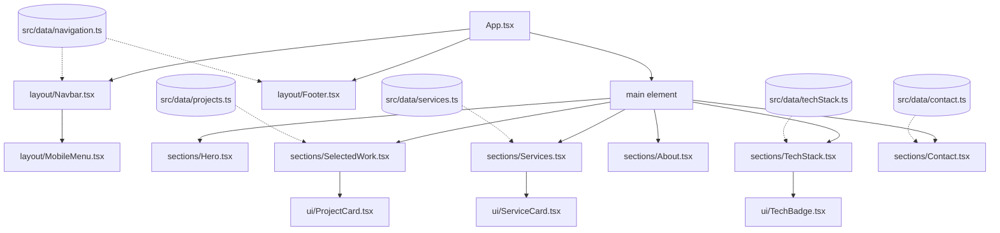

# Technical Architecture Document — Dolonda

**Project:** Dolonda  
**Author:** Senior Frontend Engineer & Creative Developer  
**Status:** Approved Architectural Blueprint  
**Version:** 1.0.0  

---

## 1. Architectural Overview & System Design

Dolonda is architected as a lightweight, high-performance, client-side Single-Page Application (SPA) built with **React**, **TypeScript**, and **Vite**, styled using **Tailwind CSS**, and hosted on the **Cloudflare Pages** global edge CDN.

```
┌─────────────────────────────────────────────────────────────┐
│                       Client Browser                        │
│  ┌───────────────────────────────────────────────────────┐  │
│  │                     React Root                        │  │
│  │   ┌───────────────────────────────────────────────┐   │  │
│  │   │  Navbar (Sticky, Mobile Drawer State)         │   │  │
│  │   ├───────────────────────────────────────────────┤   │  │
│  │   │  Hero Section (Editorial layout & CTAs)       │   │  │
│  │   ├───────────────────────────────────────────────┤   │  │
│  │   │  SelectedWork Section (Cards from data)       │   │  │
│  │   ├───────────────────────────────────────────────┤   │  │
│  │   │  Services Section (3 core pillars from data)  │   │  │
│  │   ├───────────────────────────────────────────────┤   │  │
│  │   │  About Section (Founder narrative & values)   │   │  │
│  │   ├───────────────────────────────────────────────┤   │  │
│  │   │  TechStack Section (Badges & capabilities)    │   │  │
│  │   ├───────────────────────────────────────────────┤   │  │
│  │   │  Contact Section (Direct communication CTAs)  │   │  │
│  │   ├───────────────────────────────────────────────┤   │  │
│  │   │  Footer (Wordmark, copyright, quick links)    │   │  │
│  │   └───────────────────────────────────────────────┘   │  │
│  └───────────────────────────────────────────────────────┘  │
└──────────────────────────────▲──────────────────────────────┘
                               │ Static Assets (HTML/JS/CSS/SVG)
                               │
┌──────────────────────────────┴──────────────────────────────┐
│             Cloudflare Pages (Global Edge CDN)              │
│  - Instant cache invalidation & SSL                         │
│  - Built directly from GitHub repository (`npm run build`)  │
│  - Target output directory: `dist/`                         │
└─────────────────────────────────────────────────────────────┘
```

### Architectural Principles:
1. **Decoupled Content Architecture:** All textual and structural content (projects, services, tech capabilities, navigation items) is stored in strongly typed TypeScript objects (`src/data/`), completely separated from presentation JSX.
2. **Zero Runtime Bloat:** Avoid heavy runtime dependencies (e.g., CSS-in-JS runtimes, heavyweight animation suites, bloated UI component kits). Rely on Tailwind utilities, modern native CSS transitions, and SVG vectors.
3. **Strict Type Safety:** Comprehensive TypeScript interfaces for all data contracts and component props ensure compilation-level safety and prevent regressions.
4. **Edge CDN Delivery:** 100% pre-compiled static assets deployed to Cloudflare Pages for sub-second global Time to First Byte (TTFB).

---

## 2. Technology Stack & Decision Trade-offs

| Layer | Selected Technology | Alternative Considered | Rationale & Trade-offs |
| :--- | :--- | :--- | :--- |
| **Bundler & Tooling** | **Vite** | Next.js / Astro / Webpack | **Why Vite:** Lightning-fast HMR (<50ms), minimal configuration, pure static bundle generation (`dist/`). Next.js would introduce unnecessary Node.js server dependencies or SSG complexity for a single-page portfolio; Webpack is excessively slow and complex. |
| **UI Library** | **React 18/19** | Vanilla JS / Svelte / Vue | **Why React:** Directly aligns with the founder's reactivation goals and core client service offering ("React development"). Allows modular component architecture and rich ecosystem. |
| **Type System** | **TypeScript** | JavaScript (ESNext) | **Why TypeScript:** Catches edge cases at compile-time, documents component props organically, and enforces strict data shapes. Perfect for engineering credibility. |
| **Styling** | **Tailwind CSS** | CSS Modules / Styled-Components | **Why Tailwind:** Rapid layout iteration, zero runtime JS overhead, atomic CSS deduplication in production, and simple customization of the editorial design tokens (Space Grotesk, Inter, JetBrains Mono, warm off-white, electric lime). |
| **Hosting & CI/CD** | **Cloudflare Pages** | Vercel / Netlify / AWS S3 | **Why Cloudflare:** Requirement from brief ("Do not use Vercel. I intend to deploy using Cloudflare Pages"). Superior global edge routing, unlimited bandwidth on free tier, zero vendor lock-in with static output. |

---

## 3. Directory Structure

The project follows a standard, clean, and scalable frontend structure:

```
dolonda/
├── public/                     # Static files directly served (favicons, og-image, robots.txt)
│   ├── favicon.svg
│   ├── og-image.jpg
│   └── robots.txt
├── src/
│   ├── assets/                 # Processed assets (project screenshots, concept visual graphics)
│   │   ├── projects/
│   │   │   ├── bali-villa.webp
│   │   │   └── saas-dashboard.webp
│   │   └── brand/
│   │       └── logo.svg
│   ├── components/             # Reusable UI & section components
│   │   ├── layout/
│   │   │   ├── Navbar.tsx
│   │   │   ├── MobileMenu.tsx
│   │   │   ├── Footer.tsx
│   │   │   └── Container.tsx
│   │   ├── sections/
│   │   │   ├── Hero.tsx
│   │   │   ├── SelectedWork.tsx
│   │   │   ├── Services.tsx
│   │   │   ├── About.tsx
│   │   │   ├── TechStack.tsx
│   │   │   └── Contact.tsx
│   │   └── ui/
│   │       ├── Button.tsx
│   │       ├── ProjectCard.tsx
│   │       ├── ServiceCard.tsx
│   │       ├── TechBadge.tsx
│   │       └── SectionHeading.tsx
│   ├── data/                   # Decoupled static content (Single Source of Truth)
│   │   ├── navigation.ts
│   │   ├── projects.ts
│   │   ├── services.ts
│   │   ├── techStack.ts
│   │   └── contact.ts
│   ├── types/                  # Shared TypeScript interfaces & types
│   │   ├── index.ts
│   │   ├── project.ts
│   │   ├── service.ts
│   │   └── navigation.ts
│   ├── styles/                 # Global styling & Tailwind directives
│   │   └── index.css
│   ├── App.tsx                 # Root application composition
│   ├── main.tsx                # React DOM entry point
│   └── vite-env.d.ts           # Vite client types
├── docs/                       # Project documentation
│   ├── PROJECT_BRIEF.md
│   ├── PRD.md
│   ├── ARCHITECTURE.md
│   └── DESIGN_SYSTEM.md
├── tasks/                      # Project task tracking
│   ├── MVP.md
│   └── BACKLOG.md
├── AGENTS.md                   # Collaboration rules for AI agents
├── README.md                   # Project overview & developer guide
├── index.html                  # HTML entry point with meta tags & font preconnects
├── package.json                # Project dependencies & scripts
├── tsconfig.json               # TypeScript compiler options
├── tsconfig.node.json          # Node TypeScript options for Vite config
└── vite.config.ts              # Vite configuration
```

---

## 4. Component Hierarchy & Data Flow



### Data Flow Patterns:
1. **Unidirectional Props:** Data flows strictly downward from typed data fixtures into container sections, which pass individual items into pure UI components (`ProjectCard`, `ServiceCard`, `TechBadge`).
2. **Local Interactive State:** State is limited to local view concerns:
   - `Navbar`: Mobile drawer toggle (`isMenuOpen: boolean`) and scroll position detection for header background blur (`isScrolled: boolean`).
   - `Contact`: Copy-to-clipboard status feedback (`copied: boolean`).
3. **No Global State Machine Needed:** The application does not require Redux, Zustand, or Context API for the MVP, eliminating unnecessary boilerplate.

---

## 5. Styling Architecture & Design Tokens

### Tailwind CSS Custom Configuration
The design system tokens specified in the brief are mapped directly to Tailwind utility extensions:

```javascript
// tailwind.config.js token mappings
module.exports = {
  theme: {
    extend: {
      colors: {
        canvas: '#F5F3EE',       // Warm off-white
        ink: {
          DEFAULT: '#202020',   // Charcoal
          muted: '#555555',     // Secondary text
          subtle: '#888888',    // Technical labels / borders
        },
        lime: {
          accent: '#C7F36B',    // Electric lime
        },
        indigo: {
          accent: '#7067E8',    // Indigo accent
        },
      },
      fontFamily: {
        heading: ['Space Grotesk', 'sans-serif'],
        body: ['Inter', 'sans-serif'],
        mono: ['JetBrains Mono', 'monospace'],
      },
      maxWidth: {
        container: '1200px',
      },
    },
  },
};
```

### Font Loading Strategy
Fonts are loaded using high-performance Google Font preconnects in `index.html` (or self-hosted web fonts in production) to avoid layout shift:
- `Space Grotesk` (weights 500, 600, 700)
- `Inter` (weights 400, 500)
- `JetBrains Mono` (weights 400, 500)

---

## 6. Build & Deployment Architecture (Cloudflare Pages)

### Build Pipeline:
- **Command:** `npm run build` (runs `tsc && vite build`).
- **Output Directory:** `dist/` containing pre-minified HTML, CSS, JavaScript chunks, and optimized assets.
- **Rollup Chunking:** Automatic vendor chunking ensures optimal browser caching.

### Cloudflare Pages Configuration:
- Connect directly to the GitHub repository (`main` branch).
- Automatic preview deployments for pull requests.
- Zero server-side execution; 100% static asset serving from Cloudflare's 300+ global edge locations.
- Custom domain configuration pointing `dolonda.com` to Cloudflare Pages CNAME with automated SSL.

---

## 7. Applicability of Database Schema & API Specifications

Per the project brief:
> *"No backend is required. No authentication is required. No CMS is required initially."*

Consequently:
- **`DATABASE_SCHEMA.md` is NOT applicable** for the MVP. There are no relational databases, SQL schemas, or document stores required.
- **`API_SPEC.md` is NOT applicable** for the MVP. The website does not expose or consume custom backend REST or GraphQL APIs.
- Contact interactions use client-side protocols (e.g., standard `mailto:`, prefilled WhatsApp API link `https://wa.me/...`, and external profile links).
- In the future (see `tasks/BACKLOG.md`), should a Cloudflare Worker/Serverless function be added for contact form submissions, an API specification will be introduced.
